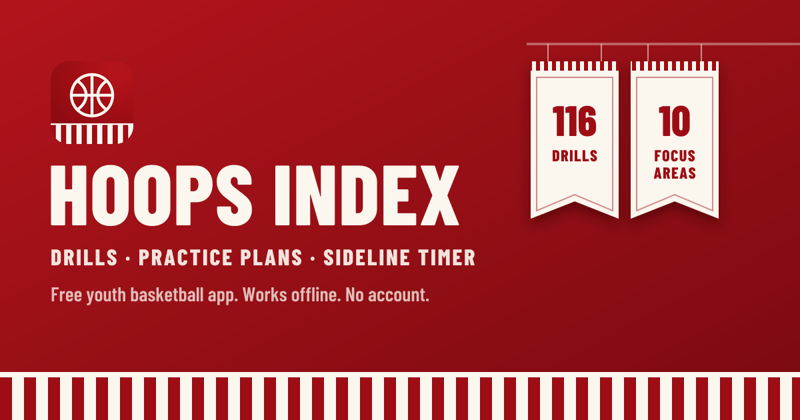

# Hoops Index: Drill Library



**Live app:** https://teefrye.github.io/hoops-index-drill-library/

A free youth basketball app for coaches: 116 drills, a practice plan builder and a sideline timer. Installs on any phone, works offline, no account.

---

## Try it / install it

Open the [live app](https://teefrye.github.io/hoops-index-drill-library/), then:

- **iPhone / iPad:** in Safari, tap **Share**, then **Add to Home Screen**. The app's **Get the app → How to** card walks you through it.
- **Android (Chrome):** tap **Install** on the app's **Get the app** card, or ⋮ menu → **Install app**.
- **Desktop (Chrome / Edge):** click **Install** on the card, or the install icon in the address bar.

Once installed it opens full-screen from your home screen and works with no signal. You can also install from **Settings → Install the app** at any time.

---

## The problem

Coaching youth basketball while working a full-time job is a scheduling puzzle that never fully resolves.

You get to the gym with 15 minutes before practice starts, sometimes less. You need to fill an hour, maybe an hour and a half, with drills that are appropriate for the age group, actually teachable in the time you have, and flexible enough to work whether 8 kids show up or 12. You don't always know which until they walk in the door.

The drills exist. They're scattered across YouTube videos, coaching websites, old notebooks, and things you half-remember from a clinic three years ago. Finding the right one fast, filtered by what you're working on, how many players you have, and what skill level makes sense today, isn't easy when you're standing in a gym parking lot trying to throw together a practice plan.

That's the problem this is trying to solve.

**Hoops Index is a drill index built for the sideline, not the desk.** A fast, filterable, mobile-first app a coach can pull up between warmups and actually use.

---

## What it does

- **116 youth basketball drills** across 10 focus areas, filterable by player count, age group, skill level, length and equipment, plus full-text search
- **Practice builder:** pick your time, roster, age and focus and get a full plan (warm-up → skill blocks → water breaks → competitive finisher), then reorder, retime, add or shuffle drills
- **Practice Mode:** a sideline timer that runs your plan drill by drill, with coaching cues on screen, whistle beeps, +1 min, and the screen kept awake
- **Saved, Recent and Notes:** star go-to drills and keep your own notes on any drill
- **Share a plan** as text with assistant coaches
- **Install anywhere:** a one-tap install button on Android and desktop, step-by-step instructions on iPhone
- **Backup & restore**, light/dark mode, no login; all data stays on the device

---

## Design

The look is inspired by classic college basketball: crimson and cream, candy-stripe warm-up pants, and championship banners hanging in the rafters.

- **Crimson headers** with a candy-stripe band on every screen, and a crimson tab bar docked to the bottom
- **Focus areas as hanging banners** on the Drills screen; tap one to filter
- **Barlow Condensed** for titles and buttons (arena-signage feel), the system font for body text
- **[Phosphor](https://phosphoricons.com) icons**, with a distinct icon per focus area
- **Practice Mode** in a dark "game night" style; finishing a practice drops a "Practice Complete" banner

Hoops Index is an independent project. It isn't affiliated with any school or team, and uses no team names, logos or marks.

---

## Drill library

| Focus | Count |
|---|---|
| Ball Handling | 17 |
| Shooting | 15 |
| Passing | 14 |
| Defense | 14 |
| Team Concepts | 13 |
| Finishing | 11 |
| Footwork | 11 |
| Warm-Up | 8 |
| Rebounding | 7 |
| Conditioning | 6 |

**Age groups:** U8–U10 · U10–U12 · U12–U14 · U14+ (each drill lists the youngest group it suits, plus an optional `maxAge` for little-kid games)

All drill write-ups are original. Classic drill concepts (Mikan, Shell, Knockout…) are common coaching knowledge, but the descriptions are written for this app rather than copied from other sites.

---

## Adding drills

1. Copy `content/example-new-drills.json` to a new file and fill in one or more drills (no `id` needed).
2. Run `npm run drills:add -- content/your-file.json`. This validates every field, assigns ids, and skips duplicates by name.
3. `npm run drills:check` validates the whole library (the build runs it automatically).

**Schema:**
```json
{
  "name": "Drill Name",
  "focus": "Warm-Up | Ball Handling | Passing | Shooting | Finishing | Footwork | Defense | Rebounding | Team Concepts | Conditioning",
  "ageGroup": "U8–U10 | U10–U12 | U12–U14 | U14+",
  "maxAge": "optional, oldest age group it suits",
  "skill": "Beginner | Intermediate | Advanced",
  "duration": 10,
  "minPlayers": 1,
  "maxPlayers": 10,
  "equipment": ["optional", "list"],
  "competitive": true,
  "setup": "What you need and how to set it up.",
  "steps": ["Step 1", "Step 2"],
  "cues": ["Coaching cue"],
  "variations": ["Variation"]
}
```

---

## Development

```bash
npm install
npm run dev           # local dev server
npm run build         # validate drills, type-check, build to dist/
npm run preview       # serve the production build
npm run drills:check  # validate src/data/drills.json
npm run drills:add -- content/file.json   # validate + merge new drills
npm run og            # regenerate public/og-image.png (link preview)
npm run icons         # regenerate app icons from public/favicon.svg
```

- **Stack:** React + TypeScript + Vite; `vite-plugin-pwa` for the offline service worker and install manifest
- **Data:** `src/data/drills.json`, bundled into the app so it works offline
- **Storage:** `localStorage` (favorites, practices, notes, settings); nothing leaves the device
- **Hosting:** GitHub Pages, deployed by `.github/workflows/deploy.yml` on every push to `main`
- **Site URL:** set in `.env` as `VITE_SITE_URL`. Link-preview tags in `index.html` need an absolute URL, so change it there if the app moves to a custom domain.

### Link previews

`index.html` has Open Graph and Twitter card tags, so sharing the link in iMessage, LinkedIn, Slack or X shows the crimson preview card. The card is generated by `scripts/og-image.mjs`: it converts the app's display font to vector paths and renders a 1200×630 PNG with `sharp`, so it looks the same on any machine. Re-run `npm run og` if the drill count or tagline changes.

### Project structure

```
├── index.html                 app shell, PWA + link-preview meta tags
├── vite.config.ts             build + PWA manifest/service worker
├── pwa-assets.config.ts       app icon generation
├── .env                       VITE_SITE_URL (public site address)
├── public/                    icons, favicon.svg, og-image.png
├── content/                   inbox for new drill files (see "Adding drills")
├── scripts/
│   ├── drills.mjs             validate / merge drills
│   └── og-image.mjs           generate the link-preview image
├── src/
│   ├── main.tsx               entry: fonts, styles, service worker
│   ├── App.tsx                tab bar + per-tab navigation stacks, swipe-back
│   ├── styles.css             design tokens and all styles (light + dark)
│   ├── store.ts               localStorage-backed stores, backup/restore
│   ├── types.ts               drill / plan / settings types
│   ├── data/                  drills.json + loader
│   ├── lib/
│   │   ├── drills.ts          filtering, search, formatting
│   │   ├── generator.ts       practice plan builder
│   │   └── install.ts         install detection (native prompt vs. iOS steps)
│   ├── components/            Icon, DrillRow, Install card/sheet, UI kit
│   └── screens/               Drills, Drill detail, Practices, Plan editor,
│                              Practice Mode, Saved, Settings
└── legacy/index.html          the original v1 single-file app
```

### iOS notes

- **Home-screen layout on iOS 26:** with the translucent status bar, iOS 26 gives installed web apps a viewport shorter than the screen and won't draw below it, which left a band under the tab bar. `styles.css` works around it by making the page itself screen-tall in standalone mode (`html { min-height: min(100lvh, calc(100% + env(safe-area-inset-top))) }`).
- iOS has no install API, so the iPhone install flow is an instruction sheet; Chrome/Edge use the native `beforeinstallprompt` dialog.

---

## Roadmap

- **Google Play:** package the PWA with [PWABuilder](https://www.pwabuilder.com) ($25 one-time developer fee)
- **App Store:** wrap with Capacitor; needs the $99/yr Apple Developer Program
- **Landing page** at the root with screenshots and a QR code, app at `/app`
- **AI drill generator:** brought back behind a small server-side proxy so the API key stays private
- **Court diagrams** for each drill
- **Cloud sync** so plans follow you across devices and coaches on the same team can share them
